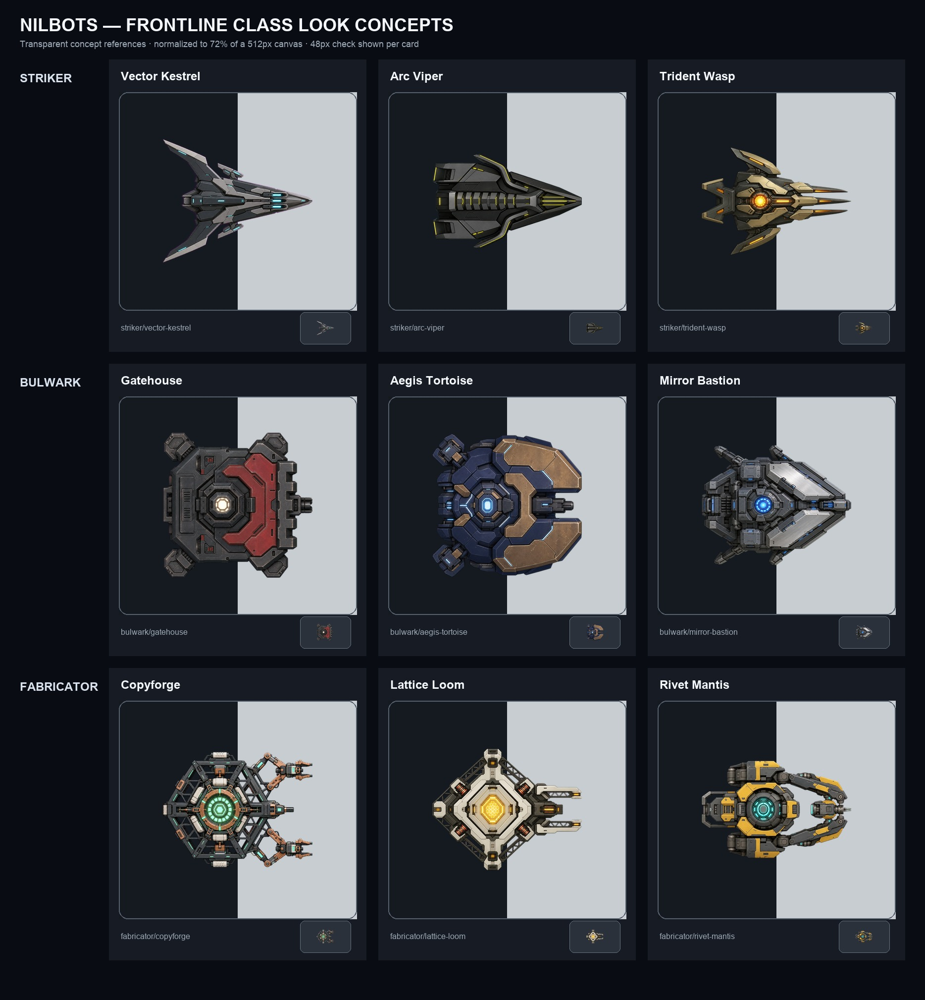
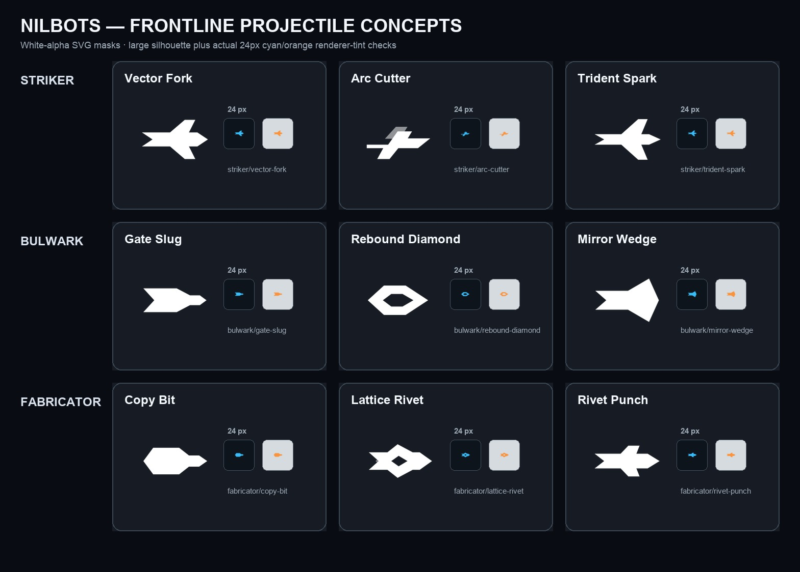
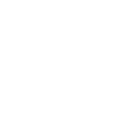
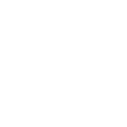
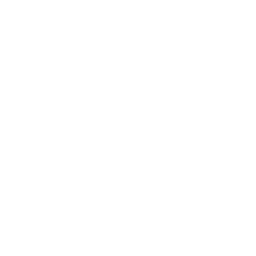
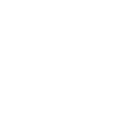

# Frontline class-look concepts

Status: **unshipped selection material**. These files deliberately have no
runtime manifests, catalog entries, entitlement policy, or appearance-editor
registration.





The concepts follow the active `agent/frontline-duel-depth` class direction:

- Striker is a narrow, facing-readable prediction duelist whose signature cast
  fires a three-lane volley.
- Bulwark is a broad fortifier with an obvious protected front, reversible
  turret commitment, and a facing-locked deflection shell.
- Fabricator is a light economy chassis that creates a **separate new instance
  of the same chassis** beside itself. It does not store children, attach them
  to itself, or grow through fabrication.

Every source is strict top-down, faces East, and was generated separately on a
flat magenta removal field. `source.png` is the untouched generated reference,
`concept.png` is the high-resolution transparent result, `preview.png` is
normalized to 72% of a canonical 512px canvas, and
`gameplay-preview.png` is the 48px legibility check.

## Candidate sets

| Class | Chassis concept | Paired projectile | Read |
| --- | --- | --- | --- |
| Striker | **Vector Kestrel** | Vector Fork | The speed extreme: long delta, three muzzle channels, least ground-bound of the set. |
| Striker | **Arc Viper** | Arc Cutter | Compact prediction wedge with curved calculation rails and the quietest volley cue. |
| Striker | **Trident Wasp** | Trident Spark | Strongest three-lane cast read; compact enough to remain a bot rather than artillery. |
| Bulwark | **Gatehouse** | Gate Slug | Heaviest mobile-door fantasy, strongest durability read, deliberately utilitarian. |
| Bulwark | **Aegis Tortoise** | Rebound Diamond | The clearest physical front quadrant and exposed rear; best match for Shell counterplay. |
| Bulwark | **Mirror Bastion** | Mirror Wedge | Sleeker deflection fantasy with a very reusable forward section for the derived turret. |
| Fabricator | **Copyforge** | Copy Bit | Most literal outward assembly tools; the busiest silhouette at gameplay scale. |
| Fabricator | **Lattice Loom** | Lattice Rivet | Repeatable lattice/hex language, distinct from both combat classes, and clear at 64px. |
| Fabricator | **Rivet Mantis** | Rivet Punch | Compact industrial manipulators and the strongest “mobile tool” read. |

The strongest base trio is **Trident Wasp + Aegis Tortoise + Lattice Loom**:
their silhouettes remain distinct without relying on player-controlled accent
color, and each says its class verb at a glance. A grittier alternative is
**Arc Viper + Gatehouse + Rivet Mantis**.

Projectile files under `projectiles/` are genuine white-alpha SVG masks on the
canonical 256 viewBox. They are suggestions, not locked chassis companions;
the eventual appearance model should continue to let players choose chassis
and projectile independently.

<table>
  <tr>
    <th>Striker</th>
    <td><br>Vector Fork</td>
    <td><br>Arc Cutter</td>
    <td><br>Trident Spark</td>
  </tr>
  <tr>
    <th>Bulwark</th>
    <td><br>Gate Slug</td>
    <td><br>Rebound Diamond</td>
    <td><br>Mirror Wedge</td>
  </tr>
  <tr>
    <th>Fabricator</th>
    <td><br>Copy Bit</td>
    <td><br>Lattice Rivet</td>
    <td><br>Rivet Punch</td>
  </tr>
</table>

## Selection-to-runtime path

1. Select one base silhouette per class and zero or more projectile masks.
2. Redraw selected chassis as genuine path-based SVG on `viewBox="0 0 512 512"`;
   do not auto-trace these raster concepts.
3. Preserve one class silhouette across its later entitled skins. Fabricator
   lives all use the same selected chassis; fabrication status is a separate
   presentation cue, not a different child body.
4. Author Bulwark mobile, turret, and Shell presentations from the same
   silhouette family. Keep the turret omnidirectional and Shell directional.
5. Add per-form look resolution to both renderers before relying on class art.
   Replay v3 carries per-form look IDs, but `main` does not yet consume them in
   both rendering paths.
6. Add class compatibility to cosmetics before selling or granting skins per
   class. Current look manifests and entitlements allow any owned look on any
   bot.
7. Only then add runtime manifests, catalog IDs, availability, and entitlement
   sources.

Exact generation prompts and chroma-removal settings are in
[`SOURCE-PROMPTS.md`](SOURCE-PROMPTS.md). Rebuild normalized previews with:

```sh
sandbox/concept-art-venv/bin/python scripts/build-class-look-concepts.py
```
