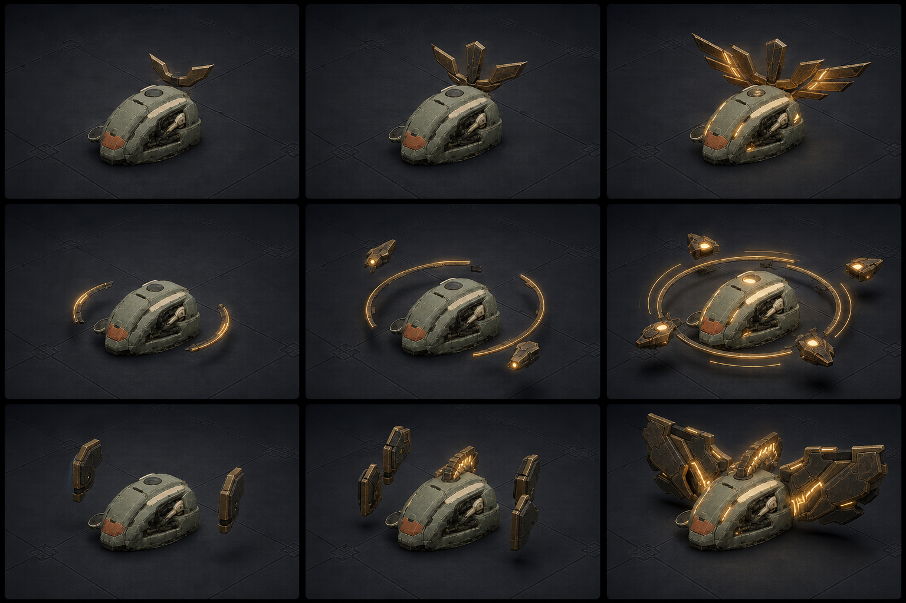
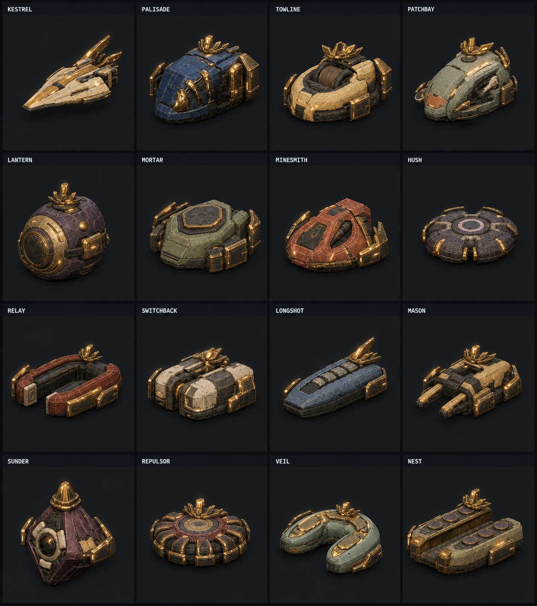

# Veterancy power-language concepts v1

Concept-only owner review artifact. Nothing in this directory authorizes a
renderer implementation.



## Full-roster stress test



The second board applies a maximum-veterancy hybrid of Crowned Core and Veteran
Mantle to the whole roster. It validates an **adaptive** grammar rather than one
shared attachment:

- long hulls carry low rear-swept crown blades;
- wide hulls receive squared flank framing around their existing mass;
- radial hulls use low crown petals and strengthened outer segments;
- open and crescent hulls preserve their negative space;
- every family shares rough brass, controlled amber seams, and a five-part elite
  rhythm.

The full-roster generation prompt is preserved in
[`FULL-ROSTER-PROMPT.md`](./FULL-ROSTER-PROMPT.md).

## How to read the board

Every row uses the same representative matte Arc chassis. The columns are
baseline veteran, mid-rank, and maximum-rank reads (roughly levels 1, 3, and 5);
levels 2 and 4 would interpolate within the chosen language.

1. **Crowned Core** — one changing overhead silhouette, from a shallow crest to
   an unmistakable winged command crown. It has the cleanest ordinary-gameplay
   footprint and does not compete with selection rings.
2. **Orbital Armor** — low broken arcs become an armored orbit with satellites.
   It reads as stored power, but has the greatest risk of looking like a field,
   selection state, or active signature.
3. **Veteran Mantle** — renderer-owned floating armor fins grow into a broad
   energized mantle. It gives the strongest elite silhouette, with the highest
   class-by-class collision and screen-clutter cost.

The art deliberately excludes numerals, stars, chevrons, medals, and vertical
rank towers. The desired read is not “this bot has rank metadata”; it is “this
bot is dangerous.”

## Generation record

- Workflow: built-in ImageGen (`stylized-concept`)
- Image 1 reference: `../arc-relay-meshy7-fleet-retexture-v3/fixed-orientation-sheet.png`
  for the current matte, worn fleet materials and chassis language.
- Image 2 reference:
  `../arc-relay-presentation-batch-v1/runtime-proof/captures/level-up.webp`
  for the real top-down arena camera, darkness, and gameplay scale.
- Image 3 reference: `../arc-relay-presentation-batch-v1/04-control-level-up.png`
  for contact-sheet presentation only; its chevron solution was explicitly
  rejected.

Final prompt:

```text
Create a polished landscape game-concept comparison board exploring three
renderer-feasible ways to make a veteran Nilbots unit visibly read as
increasingly powerful without numbers, stacked chevrons, stars, text, or a
conventional rank badge. Use the exact matte, worn industrial sci-fi bot style,
the real top-down 3D arena scale and darkness, and the established Nilbots
contact-sheet presentation.

Repeat the same compact low combat bot consistently in a 3-by-3 grid. Columns
show baseline veteran, clearly stronger mid-rank, and unmistakable maximum-power
elite. Row 1, Crowned Core: evolve one shallow angular brass crest behind the
chassis into a broad five-prong winged crown with restrained warm seams. Row 2,
Orbital Armor: evolve one low broken amber orbit into a controlled double orbit
with four angular armored satellites and concentrated core glow. Row 3, Veteran
Mantle: evolve one pair of small matte-brass flank fins into a broad wing-like
armored mantle with energized inner seams.

Use identical three-quarter top-down camera and bot scale in all cells, dark
graphite industrial tiles, cool ambient light, matte scuffed metal, rough brass,
and controlled translucent hard-light. No text, labels, numerals, letters,
stars, chevrons, medals, floating UI, health bars, giant vertical towers,
opaque spheres, excessive particles, fire, lightning storms, lens flares, new
characters, glossy plastic, or watermark. Keep all nine bots recognizable as
the same chassis. Maximum rank must look dramatically more powerful than
baseline even when squinting at the full sheet.
```
