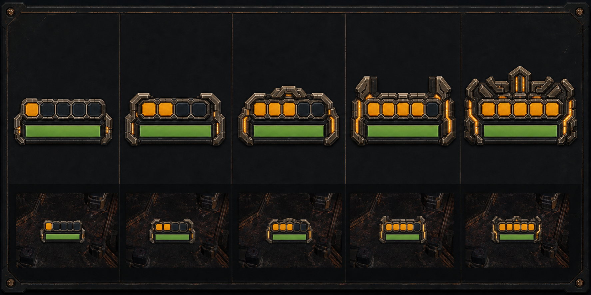

# Veterancy power frame v3

Hybrid concept and rejected renderer-native trial. It kept the exact-readable
five-cell rank rail from v2 but added a progressively assembling flat 2D command
frame that did not look good in play. Runtime returned to one fixed rail and
moved the power progression into rank-specific color instead.



## Proposed grammar

Two visual channels do separate jobs:

- **Exact rank:** all five rail cells remain visible and level `N` energizes
  exactly the first `N` cells from left to right.
- **Power:** the surrounding camera-facing frame gains width, height,
  structural mass, and controlled amber seams at every level.

The health bar remains centred, fixed-width, and unobscured. Level 1 is a
compact framed veteran read. Level 3 has clear armored shoulders. Level 5 is a
low, broad five-part command mantle intended to read like a mini-boss frame
even without counting cells.

The Tapline implementation deliberately replaces the board's darker brass cue
with unlit pale alloy (`#e1f2f0`) behind a near-black clearance keyline. Real
gameplay frames showed that the darker material would lose its silhouette on
the copper-black floor. Amber remains exclusive to energized cells and seams.

This is flat renderer-owned status geometry, not a bot attachment. It does not
revive the rejected 3D wings, crown models, orbitals, floor fields, or tiny
standalone silhouette badges. The upper row is the construction view; the
lower row is the decision-critical gameplay-scale test.

## Generation record

- Workflow: built-in ImageGen
- Use case: `stylized-concept`
- Output: `1774 × 887` RGB PNG
- SHA-256:
  `ea94e3dff35277dc121fe106d63ef1351fc5b989d2da1be8e70fabd3247345c0`
- Reference 1: `../veterancy-rank-rail-v2/veterancy-rank-rail-concept-v2.png`
  for fixed five-cell readability and current health-bar placement.
- Reference 2: `../veterancy-rank-plates-v1/veterancy-rank-plates-concept-v1.png`
  for the earlier matte command-silhouette language.
- Reference 3: `../veterancy-power-concepts-v1/veterancy-power-directions.png`
  for dangerous-power progression only; no physical attachment is retained.

Final prompt:

```text
Use case: stylized-concept
Asset type: one landscape game-UI concept sheet for Nilbots veterancy readability and power
Primary request: Create a new v3 HYBRID veterancy treatment. Preserve the exact-readable fixed five-cell rank rail from Image 1, but make the surrounding flat 2D health-row frame progressively communicate dangerous power. This is a replacement concept, not an edit of the runtime. Show exactly five authoritative states from level 1 through level 5, left to right.
Input images: Image 1 is the readability baseline: keep its fixed health bar and exact five-cell fill grammar. Image 2 is a material and evolving-command-silhouette reference, but its tiny standalone badges were unreadable and must not return. Image 3 is a power-language reference only: translate its broad veteran/elite visual weight into a flat camera-facing HUD frame; do not create physical bot wings, orbitals, or 3D attachments.
Scene/backdrop: restrained dark Nilbots review board with a second strip of honest tiny gameplay-scale mockups over varied Tapline-like dark copper and black floor swatches.
Subject: Every state has the same centered horizontal health bar and exactly five large rail cells immediately above it. Level N lights exactly N amber cells and leaves the others visibly dark. Around that stable readable core, a flat 2D command frame grows in visual authority: level 1 has compact low end brackets and little energy; level 2 gains stronger stepped corners; level 3 gains broad armored shoulders and a small central peak; level 4 gains wider split shoulder blades and brighter recessed seams; level 5 becomes a low, broad five-part elite command mantle framing the health row, with a strong central crest and energized inner channels. The level-5 frame should read like a mini-boss or highly dangerous veteran even when squinting, but stay horizontally compact and never obscure the bar or cell count.
Style/medium: polished flat 2D game UI concept art, vector-friendly, orthographic camera-facing overlay, crisp hard edges, matte industrial sci-fi broadcast HUD. It is decorative UI framing, not a physical object on the bot.
Composition/framing: wide 16:9 board; exactly five equal columns; one enlarged row above and one tiny gameplay-scale row below; perfect horizontal alignment. The bottom row is decision-critical and must show both exact rank count and obvious growth in power.
Lighting/mood: unlit, high-contrast UI treatment with controlled energized seams; imposing rather than flashy.
Color palette: near-black outer keyline, cool pale-metal structural frame, blue-black empty cells, restrained warm amber rank cells and internal energy seams, existing green health fill. Use more amber coverage at higher ranks without excessive glow.
Materials/textures: mostly flat matte enamel and worn metal cues, simplified enough to survive tiny rendering.
Constraints: exactly five states per row and exactly five rail cells in every state; state N has exactly N amber cells; health bar width, fill, and center position stay identical across all states; the power frame may grow outward and slightly upward around the reserved center without moving the health bar. No text, labels, number, Roman numeral, conventional chevron stack, star, medal, shield badge, separate floating plate, 3D bot, physical wings, feathers, orbit, satellites, aura circle, particles, bloom cloud, opaque sphere, floor ring, glossy metal, watermark, or extra icons. Do not sacrifice the exact cell count for decoration.
```
