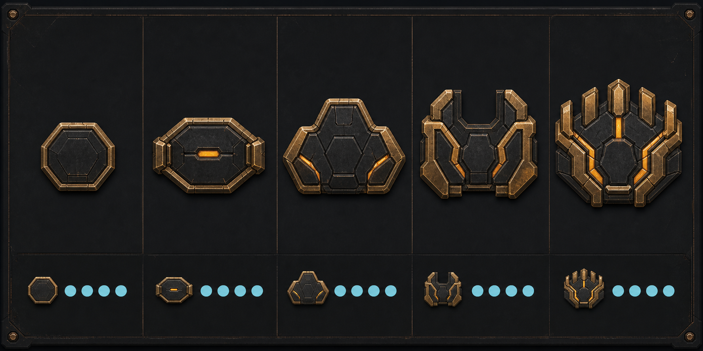

# Veterancy rank plates v1

Concept source for the current renderer-native in-game trial. Final acceptance
still depends on owner review at ordinary gameplay scale.



## Proposed grammar

Only one plate is visible at a time. The upper row shows the shape language.
The generated lower row used the then-available four-pip reference; health is
now a fixed-width bar, so those pips are stale placement shorthand rather than
runtime direction. The retained idea is one compact left endcap beside the
current health bar.

1. **Level 1 — Seed:** compact dark hexagonal plate with a restrained brass
   edge.
2. **Level 2 — Kindled:** slightly wider stepped plate with one small amber
   inlay.
3. **Level 3 — Proven:** broader three-lobed command plate with energized
   shoulders.
4. **Level 4 — Elite:** heavy split-crown silhouette with an open center.
5. **Level 5 — Apex:** full five-point command crest with focused amber seams.

The persistent treatment deliberately avoids numbers, Roman numerals, stars,
chevrons, medals, wings, team colors, and accumulating rank marks. Rank is
communicated by the silhouette and controlled energy of one evolving plate.

The relative scale in the lower strip remains useful, but its health-pip form
is obsolete. Levels 4 and 5 still need gameplay review for whether they are
appropriately rewarding or too dominant beside the bar. Final renderer-native
shapes are reconstructed as crisp geometry rather than shipping this generated
raster directly.

The runtime adaptation also replaces the concept's brass structural rim with
cool pale metal. Tapline's floor already carries dark copper and brass detail,
so amber is reserved for the rank-energy inlays and the plate remains distinct
at ordinary gameplay scale.

## Generation record

- Workflow: built-in ImageGen
- Use case: `stylized-concept`
- Output: `1774 × 887` RGB PNG
- SHA-256:
  `3b503d622df92e7a8c30c6712f7821ddfb7868746e34b5dd211740018918d18c`
- Reference 1:
  `../arc-relay-veterancy-modules-meshy7-v1/runtime-game-review/desktop-director-tick-34.png`
  for real health-pip scale and placement.
- Reference 2:
  `../veterancy-power-concepts-v1/veterancy-crowned-mantle-full-roster.png`
  for matte brass, graphite, and amber veterancy language.

Final prompt:

```text
Use case: stylized-concept
Asset type: one landscape game-UI concept sheet for owner review
Input images: Image 1 is a scale and UI-placement reference for Nilbots' real
floating health pips and dark arena; Image 2 is a material and art-direction
reference for the matte worn brass, graphite, and restrained amber veterancy
language. Generate a new concept sheet; do not edit either reference.

Primary request: infer one coherent family of FIVE distinct flat 2D veterancy
rank plates, presented together on one review board. Only one plate is shown on
a bot at a time. The five designs progress clearly from modest veteran at level
1 to unmistakably elite at level 5.

Layout: a clean wide board with five equal columns. In the upper two-thirds,
show one enlarged isolated front-facing plate per column, all centered and at
comparable scale. In the bottom third, repeat each plate at actual tiny
gameplay-HUD scale attached as a LEFT ENDCAP to a short row of four circular
health pips inspired by Image 1. Keep the miniature examples readable and
evenly aligned. Thin separators and restrained dark industrial presentation
background.

Design progression:
1. Level 1: compact low hexagonal seed plate, mostly dark graphite with a narrow
aged-brass edge, almost no light.
2. Level 2: slightly wider plate with a small central amber inlay and two
shallow side steps.
3. Level 3: broader three-lobed/stepped command plate with stronger brass
shoulders and two restrained amber seams.
4. Level 4: heavy split-crown silhouette with a central open notch, wide
confident shoulders, controlled amber inset.
5. Level 5: full elite command crest with five short articulated crown points,
strongest silhouette and richer worn brass, focused amber energy in recessed
channels, still compact enough for crowded combat.

Style/medium: polished flat 2D game UI concept art, vector-friendly
silhouettes, crisp hard edges, subtle PBR-like painted metal texture,
orthographic front view. These are UI plates, not physical 3D wings.
Color palette: charcoal graphite, aged matte brass, tiny warm amber energy
details; neutral cyan health pips in the miniature mockups.
Lighting/mood: controlled and readable, no excessive glow; dark sci-fi
broadcast UI.
Constraints: exactly five unique plates in one horizontal progression and
exactly five matching miniature health-pip mockups. The plate is always left of
the pip row and never overlaps it. All plates share one design grammar. No
plate contains text, numbers, Roman numerals, letters, stars, conventional
military chevrons, medals, skulls, team color, faction logos, or literal
shields. No wings, feathers, horns, swords, tall towers, 3D bot attachments,
characters, bot bodies, health-bar text, status text, particles, lens flare,
large bloom, glossy plastic, watermark, or extra icons. Any column labels are
optional and must remain outside the plate; prefer no text rather than
malformed text.
```
