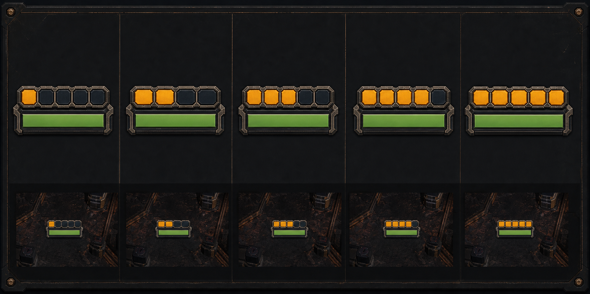

# Veterancy team-color rank rail v2

Replacement concept for the silhouette-only veterancy plates. The v1 crests
were attractive when enlarged, but their exact rank collapsed at ordinary
gameplay scale. This fixed rail returned to the renderer after the larger v3
power-frame trial added visual weight without looking good in play.



## Proposed grammar

The separate badge is gone. One fixed five-cell rail sits directly above the
current health bar. Every cell is always present; authoritative level `N`
energizes exactly the first `N` cells from left to right.

- Level 1: one team-colored cell, four dark cells.
- Level 2: two team-colored cells, three dark cells.
- Level 3: three team-colored cells, two dark cells.
- Level 4: four team-colored cells, one dark cell.
- Level 5: all five cells energized in the same team color.

This trades silhouette progression for an explicit count at the scale the game
actually renders. The fixed footprint prevents the health row from moving on
level-up. The rail rim and energized cells use the same authoritative team
accent as the health-bar frame at every rank. Color therefore reports team and
cell count alone reports level. A near-black keyline and pale-metal cell outlines
keep the rail separate from Tapline's dark copper floor.

The original concept raster below uses amber as a construction color. Runtime
does not ship that palette: its flat unlit team material has no bloom, so arena
lighting cannot hide or exaggerate a rank.

The upper row is an enlarged construction view. The lower row is the
decision-critical gameplay-scale test. The renderer should reconstruct this as
flat unlit geometry; the generated raster is not a runtime asset.

## Generation record

- Workflow: built-in ImageGen
- Use case: `stylized-concept`
- Output: `1774 × 887` RGB PNG
- SHA-256:
  `59b6785c414dc0eb3f7f186eb205cd8611398d5be936835a1a74127c78c3adf7`
- Reference 1: `../veterancy-rank-plates-v1/veterancy-rank-plates-concept-v1.png`
  for the prior matte industrial language and rejected silhouette grammar.
- Reference 2: a real targeted Tapline runtime capture at level 5 for current
  health-bar scale, camera angle, floor palette, and contrast.

Final prompt:

```text
Use case: stylized-concept
Asset type: one landscape game-UI concept sheet for Nilbots veterancy rank readability
Primary request: Design a completely new 2D veterancy indicator that abandons the tiny standalone silhouette plate. Use one fixed five-cell RANK RAIL integrated directly along the top edge of the existing horizontal health bar. Show exactly five authoritative states from level 1 through level 5, left to right. In state N, exactly N of five large chunky cells are brightly energized and all remaining cells are visibly present but dark. The count must be unmistakable at tiny gameplay size.
Input images: Image 1 is the prior material/style concept and a failure baseline; retain its matte industrial sci-fi language but do not reuse its five changing silhouettes or obsolete health pips. Image 2 is a real Tapline in-game crop and is the authoritative scale, camera angle, dark copper floor, and current horizontal health-bar reference.
Scene/backdrop: restrained dark review board with a second strip of real-gameplay-scale mockups over varied dark copper/black Tapline-like floor swatches.
Subject: top row contains exactly five enlarged health-bar-plus-rank-rail states, ordered 1, 2, 3, 4, 5. Bottom row repeats exactly those five at honest tiny gameplay scale. Each example uses the same fixed-width green health bar and the same fixed five-cell rail. Cells fill left to right. Empty cells remain outlined and readable. The rail is thin and compact, with enough separation from the bar that it cannot be mistaken for health.
Style/medium: polished flat 2D game UI concept art, vector-friendly, orthographic, crisp hard edges, matte broadcast HUD rather than physical 3D hardware.
Composition/framing: wide 16:9 board; five equal columns; enlarged row above, tiny scale-test row below; generous spacing and perfect horizontal alignment.
Lighting/mood: unlit high-contrast UI treatment, no scene lighting dependency.
Color palette: near-black outer keyline, cool pale-metal structural frame, blue-black empty cells, restrained warm amber energized cells, existing green health fill. Amber is reserved for rank only. Strong contrast over copper and black floors.
Materials/textures: almost flat matte enamel with only very subtle wear; keep tiny examples clean.
Constraints: no text or labels inside the image; exactly five states per row and exactly five cells in every rank rail; level N has exactly N amber filled cells; fixed health-bar width and position in every state; no separate badge, shield, number, Roman numeral, chevron, star, wing, crown, medal, pip health display, bot model, particles, bloom, glow haze, glossy metal, gradients that obscure fill state, watermark, or extra icons. The bottom row must honestly demonstrate that all five levels remain countable at real gameplay scale.
```
