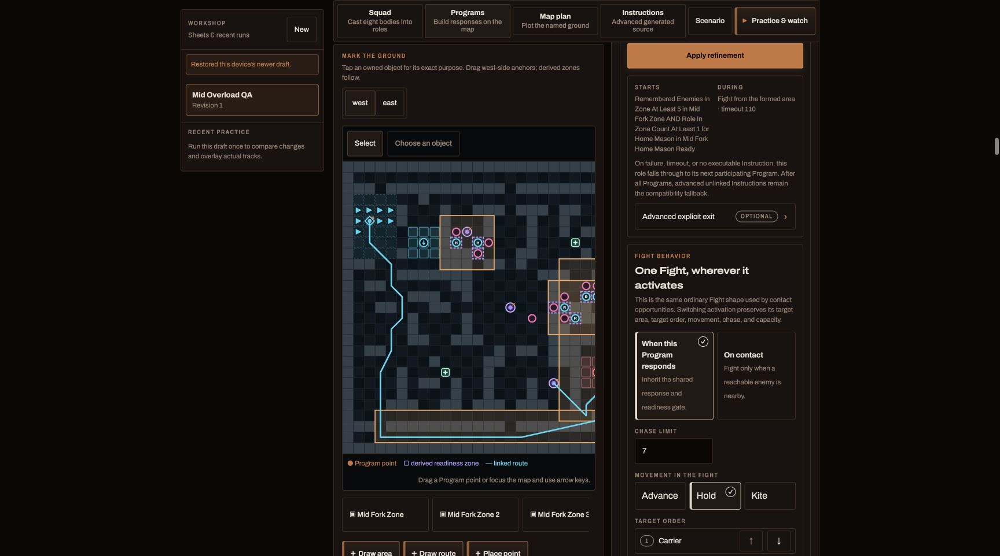
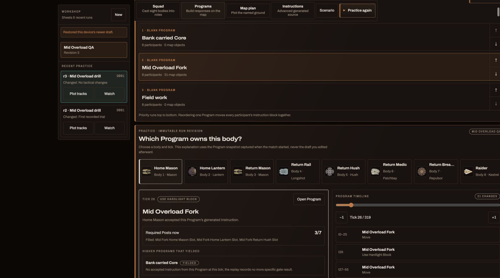
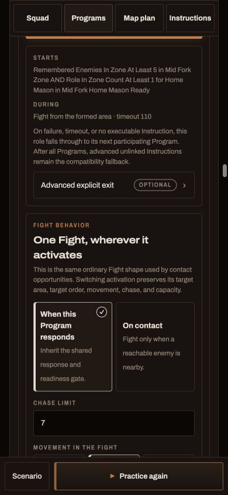
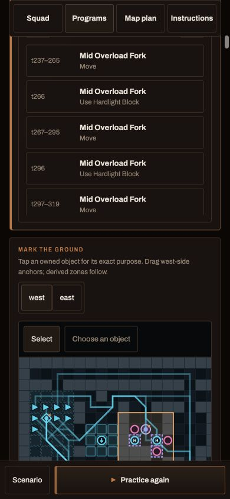

# Arc Relay player-ready Programs report

Status: **implemented for owner review**

Date: 2026-08-17

Baseline: `68a24d41`

Implementation commits: `7fc99233`, `c40abac9`, `6a7cb36c`, plus the
closing report commit cited in the handoff

Evidence rules/map: `arc-relay-tapline-08` / `arc-relay-tapline-02`

## Outcome

Programs are now the normal map-first strategy surface. A player authors one
top-to-bottom Program list; each role receives the applicable generated
Instruction blocks in that same order. Generated Instructions and Conditions
remain inspectable Advanced output, but ordinary Program authoring no longer
requires wiring them by hand.

The Core-custody amendment is implemented without a banking link or a second
runtime. An activated durable Program may contain participant-local carrier,
escort, transfer, signature, Fight, healing, Drop, and bank behavior. Those
branches stay beneath the existing Program host, inherit its commitment and
hard timeout, and use current custody state locally. The parent completes only
on its authored bank, abort, loss, or timeout outcome.

There is still:

- no Program runtime identity or mutable Program state;
- no Program-to-Program call, jump, phase, transition, or reservation;
- no atomic activation or second scheduler; and
- no priority beyond the generated ordinary Instruction order.

## Custody acceptance follow-up

The review follow-up is implemented without changing the architecture above
and without refining Running Relay:

- Health recovery now exposes **Allow Core carriers to recover**, default off.
  The editor owns and atomically rewrites the empty-handed entry Condition and
  became-carrier abort Condition when this is toggled; create, on, off, and
  serialized reload are pinned in one focused test.
- A Program's Core handling is an ordered list of value/source cases. Each case
  may generate its own return, escort, Fight, recovery, signature, Handoff, and
  Drop children for each participant. Moving a case moves those ordinary
  sibling Instruction blocks together. No runtime case identity was added.
- Static analysis warns when an earlier case accepts every Core a later case
  could accept. A specific 4-point case, a cheaper 1-point case, and an Any
  Core fallback are pinned in generated priority order.
- The common Handoff choices are shortcuts over the existing `handoff` leaf:
  adjacent ally closer to the reactor, adjacent member of a named role, or no
  Handoff. An unavailable target produces no proposal, so the next sibling—
  including return movement—remains eligible in the same tick.
- Long generated custody ids exposed a collision between a newly wrapped
  continuation and its first Opportunity. Opportunity insertion now detects
  that normalized-id collision and deterministically re-keys the child.

The existing same-Core evidence correlation remains the transfer mechanism:
after Handoff or Arc Toss, the old carrier's branch ends, the receiver's first
matching case becomes eligible, and role-scoped escorts resolve the new
carrier. No scheduler, reservation, transition, or additional Instruction
depth was introduced.

The controlled site-review fixture had drifted behind the current editor
contract (starter catalogue, class signature authoring, distinct-class floor,
and current map id), leaving the review page stuck while restoring a draft. It
now loads the real Recommended First starter and the current Tapline editor
surface, so the custody interaction remains browser-reviewable rather than
being covered only by source assertions.

The focused public proof gallery is:

<https://maiden-tutorials-atom-infrared.trycloudflare.com>

It contains four deterministic mechanics fixtures. Idle/drill opponents are
intentional, eligibility is explicitly bypassed, and nothing in it is a
balance claim. Exact hashes are in
[the evidence ledger](assets/player-ready-programs/evidence.json).

## Program-scoped Core custody

### Lifecycle

The implementation now reflects the executor's real lifecycle: once a node
with `until` is active, its entry `when` is not re-evaluated every tick. A
focused runtime test pins that behavior. Program generation therefore does not
blanket-inject `self-carrying = 0`, nor does becoming a carrier implicitly end
the parent.

Instead:

- parent trigger, readiness, commitment, timeout, and overall outcome live on
  the durable host;
- a carrier branch is eligible only while that participant carries a matching
  Core;
- ending one carrier branch does not end the Program;
- the receiving participant's branch becomes eligible after Handoff or Toss;
- escorts resolve the current carrier from declared Program roles; and
- the parent may correlate acquisition, transfer, Drop/loss, and bank events
  for the same authoritative Core before it exits.

Higher Programs may still pre-empt through ordinary top-to-bottom evaluation.
A standalone Core Custody Program remains possible only as an ordinary higher
override or lower fallback; nothing links to it.

### Minimal ordinary Instruction vocabulary

The DSL/compiler and direct executor gained only generic, role-qualified
queries needed to express that behavior:

- friendly carrier count filtered to declared roles;
- nearest friendly Core carrier filtered to declared roles;
- carried Core bank value and source Well;
- pickup/catch evidence since node entry, filtered to roles;
- bank evidence since node entry, filtered to roles, value, source, and same
  Core where requested; and
- voluntary Drop and loss evidence for explicit abort outcomes.

The evidence ledger propagates Core identity through pickup, Handoff, Arc Toss,
Drop, loss, and bank. These are immutable historical queries; there is no
`active-program` fact.

An incidental Core is still physically collectible. An authored local branch
may Drop or transfer an unwanted Core; an accepted Drop consumes that tick and
the engine's source-reclaim interval prevents the dropper from immediately
reacquiring that same Core. No hidden pickup veto, avoidance policy, or discard
action was added.

## Player-facing authoring

### One map-first surface

The Program editor now provides:

- exact Posts with tolerance, cardinal facing, and readiness;
- routes and patrol routes with draggable waypoints;
- signature locations, caster-to-target lines, deployment footprints, range,
  and line-of-sight guidance;
- map pan/zoom and a phone viewport that does not clip the east side;
- shared trigger and mixed-role readiness generation, including the 5/5 Mid
  Overload gate;
- ordered Fight, Core recovery, health recovery, signature, Handoff, and Drop
  opportunities on Move, Hold, Route, and Patrol hosts where applicable; and
- authored Core value/source filters for pursuit, return, transfer, Drop, and
  escort behavior.

The ergonomic Mason case is covered directly: “stand on this Post, face this
direction, and maintain Hardlight on this target.” Moving either map point
updates the generated Instruction, Conditions, and target automatically. The
same source also supports generic Kestrel route Dash and Relay Toss/Handoff;
there is no ability-specific `via` runtime or Toss state machine.

### “If this Program gains a Core”

Each Program has a visible custody section. The default applies its local
custody source to all applicable durable participant hosts. Where several hosts
exist, the UI shows and can narrow that scope without exposing duplicate raw
Instructions.

For each participant/carrying state, read-only analysis reports whether custody
is:

- handled inside the active Program;
- pre-empted by a higher Program;
- handled by a lower fallback after exit; or
- uncovered.

Warnings cover shadowed local custody, unreachable fallback ordering,
incidental pickers without handling, return routes that cannot fit the parent
timeout, team-wide carrier targeting where role scope was intended,
`self-carrying` used as both continuation and parent completion, completion when
only one carrier becomes empty during transfer, and possible pickup/Drop
repetition. The old `linkedBankProgramId` is removed as configurable semantics;
legacy input is discarded during normalization rather than honored.

### Priority and Practice explanation

The editor derives fallthrough from the actual Program list. For a selected
role/state it explains the controlling Program, rejected higher Programs,
likely continuation after pickup/success/timeout/death/condition loss, shadowed
Programs, and uncovered carrying/injured/idle states.

Practice stores an immutable authoring snapshot with the trial revision. The
selected-body lens maps runtime source ids back to:

- the active parent Program and why it originally activated;
- its current local custody branch;
- deliberate versus incidental acquisition and Core value/source;
- current carrier role and role-scoped escort target;
- accepted/rejected Fight, Core, healing, signature, Handoff, Toss, and Drop
  opportunities;
- custody changes and correlated bank/Drop/loss evidence; and
- completion, timeout, normal fallthrough, or higher-priority pre-emption.

It describes pre-emption as priority evaluation, never as a Program call.

### Veteran strategy

`highest-veteran` is available as a normal capacity-backed participant
selection, and role following can resolve the highest veteran. Allocation is
deterministic. The focused test removes the selected level-four body and proves
that the next eligible level-four body is selected, rather than pinning a
roster slot.

## Starter posture

- **Recommended First** is the sole recommended starter. It uses only classes
  available to a fresh account and gives every role understandable field and
  custody fallbacks.
- **Mid Overload Fork** is an Advanced tactical example.
- **Running Relay** is an Experimental coordination/mechanics example and is
  not selected by catalogue position.
- Meaningful Programs retain their authored names; the UI uses “Custom
  Program” only where no meaningful name exists.

The tracked generator runs directly with Node and reproduces all 14 generated
playbook, map-plan, and workshop files byte-for-byte without a test-only loader.

## Deterministic acceptance evidence

### Program-scoped Running Relay

`running-relay-v1` versus `idle-field-v1`, seed 9001:

- the south Core is acquired under one durable Program;
- Arc Toss departures/catches occur at ticks 67/68, 100/102, and 142/143;
- custody moves Relay A → Relay B → Relay A → Relay B;
- the medic's role-scoped carrier target follows the same sequence;
- the parent remains active through transient trigger/readiness loss and all
  three transfers;
- Relay B banks the same Core at tick 157;
- the correlated bank ends the participant hosts at tick 158 and ordinary
  lower field work takes over; and
- replay hash `536326979d9638a199238ba5f6efcdf098982f2241dfe1b945435df6530216a8`,
  gameplay-state digest
  `c4973299609e07ef88e474b1487c72cb3a120716b8335b4692d64748be4892a9`.

The identical no-Toss route control banks at tick 167. Running Relay therefore
banks 10 ticks earlier in this deterministic mechanics fixture. This is not a
combat or balance verdict.

### Unwanted incidental Core

The proof runner has no deliberate Core-recovery Instruction and physically
crosses the north Well:

- incidental pickup and accepted Program-local Drop both occur at tick 51;
- the parent exits on the correlated voluntary Drop at tick 52;
- ordinary fallback moves the body away;
- reclaim protects the same Core through tick 53; and
- no repeated pickup/Drop cycle occurs.

Replay hash:
`db7adc272536512c95bda5752681a0317ea957a39f4570f1743a0e0013e3b4a1`.
Gameplay-state digest:
`3bcaf27afb38e1c54923a44aa443caecd38cc6e17b4cff41ebaacb3e10bd4b77`.
The max-tick ending is intentional for this idle mechanics fixture.

### Mid Overload Fork

The corrected deterministic drill gathers all eight visible opponents in one
east-side overload zone so the authored response is actually exercised:

- independent raider begins at tick 0;
- Vector Dash is accepted at tick 21;
- home and return Hardlight are accepted at ticks 24 and 36;
- all five return participants enter their committed response at tick 71;
- the independently gated home Mason responds at tick 84; and
- the match ends at tick 322.

Replay hash:
`f10ad1dca6623979bd7eab63c33f3821e0eb7f7124fda4f4df47b51251d58348`.
Gameplay-state digest:
`ac81c888d3ea7ab989bbd8b3bfb401b1e0b3d4710a5b1588056aeaa41c057e81`.
The opponent is a scripted readiness fixture, not a balance opponent.

### Promoted Well rule

Tapline-8 remains Current. Focused engine tests prove:

- initial births match Tapline-7;
- pickup, carrying, Toss, Drop, and steal do not start recharge;
- banking into either reactor starts exactly one public 46-tick recharge;
- the next Core is born exactly on the due tick;
- no duplicate or old global-beat birth occurs while a Core remains active;
  and
- Tapline-7's frozen rules and map fingerprints remain unchanged.

## Browser and gallery QA

The original player-ready pass was exercised against a production web build
and local PostgreSQL App on desktop and 390×844, including Post movement,
facing, maintained deployment, readiness, Fight editing, Practice, immutable
revision attribution, reload, and phone overflow. Those screenshots remain the
visual record:

The custody follow-up received a fresh controlled production-build browser
pass. It created a second case, selected a 4-point/source-specific filter,
added carrier behavior, selected a named adjacent-role Handoff, reordered the
specific case above Any Core, and observed the shadow warning clear. The
carrier-recovery switch was exercised off → on → off, with the displayed
semantics changing each time. The map-first inspector had no document-level
horizontal overflow (`1728 / 1728` client/scroll width) or error boundary. Its
narrow-column filter and behavior panels were stacked after visual review so
labels remain readable at inspector and phone widths. Running Relay and its
proof gallery were deliberately not regenerated or refined in this follow-up.

## Validation

| Check | Result |
| --- | --- |
| `dotnet build BotArena.sln -c Release` | passed, 0 warnings / 0 errors |
| full solution tests, Release, serial | 2,349 passed; 3 environment-gated skips |
| Engine tests | 1,539 passed |
| tactical-mind tests | 39 passed |
| CLI/compiler tests | 259 passed |
| App tests with PostgreSQL | 303 passed; 3 environment-gated S3/toolchain skips |
| Determinism tests | 17 passed |
| Runtime.Wasm tests | 69 passed |
| SDK / Guest tests | 87 / 36 passed |
| `cd web && npm test` | 600 passed |
| `cd web && npm run build` | passed |
| `bash scripts/generate-api-clients.sh` | passed, no generated-client drift |
| direct starter generator comparison | 14 / 14 tracked outputs byte-identical |
| `git diff --check` | passed |

The full solution's first parallel invocation made the App's 1.6-second hosted
performance test contend with seven other test projects and measured 1.776
seconds. The same complete App suite passed in isolation, and the full solution
then passed serially. No threshold or product code was changed to hide that
runner-contention result.

## Known limits and release posture

- This is an authoring/mechanics pass, not a balance pass. Running Relay remains
  Experimental and Mid Overload remains Advanced.
- Natural-language “four enemies destroyed” style outcomes remain a follow-up;
  the underlying ordinary condition/evidence escape hatch is available in
  Advanced.
- The focused public gallery deliberately bypasses felt-eligibility because an
  idle opponent and a horizon fixture are part of the proof. It is labelled
  accordingly.
- No hosted playlist, rating era, release, deploy, or tracked tactical WASM
  rebuild was performed. The design loop used the trusted in-process path.
