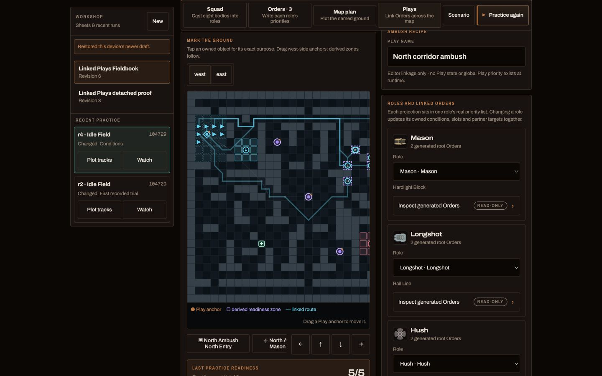
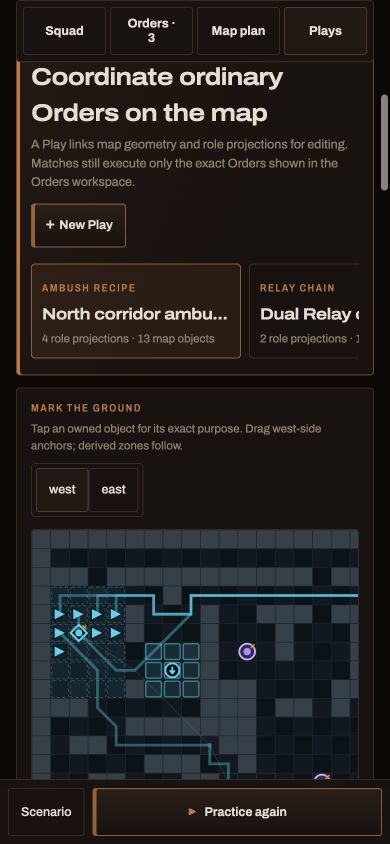
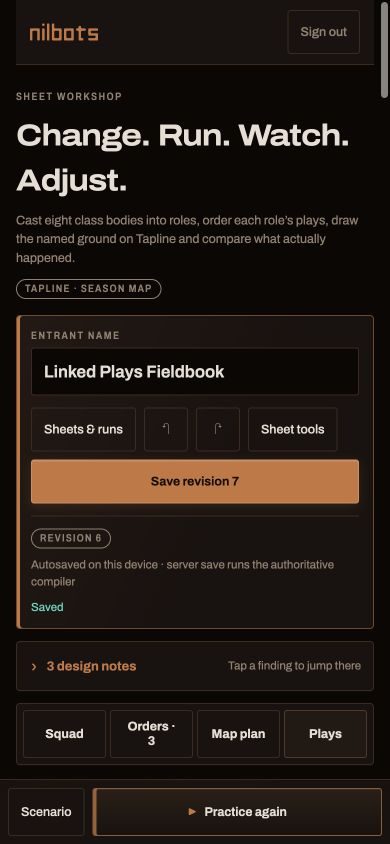

# Linked Plays authoring report

Date: 2026-08-16

Branch: `main`

Base implementation commits: `3ccc558e`, `3efe71ed`, `f91cdd52`

## Result

Arc Relay now has a real, server-backed **Plays** workspace. A Play is an
editor ownership object that updates several existing Orders and map objects as
one tactic. It is not game state: the shared compiler still receives only the
normal Orders v2 document and map plan, and the executor still sees only ATL2.
The corrected Running Relay lens did expose two missing generic Orders words:
forward progress on a named-role Arc Toss target and the body's age since its
last successful signature use. Those are compiler/executor vocabulary, not
workshop state.

The full browser flow was exercised against the persistent local PostgreSQL
volume: cast a squad, create both acceptance Plays through visible controls,
place/edit their geometry, inspect their generated Orders, save, run Practice
against Idle Field, return with tracks and selection intact, duplicate the
sheet, detach the Plays, and save the detached ordinary sources through the
server compiler.

## Persistence and identity

`TacticalSheet.WorkshopJson` is nullable PostgreSQL `jsonb`. The API accepts it
only with an explicit `replaceWorkshop` flag and validates a versioned
`arc-relay-workshop-v1` root. Older clients that omit both fields preserve the
current sidecar. The create-copy path copies it.

The sidecar is deliberately absent from `TacticalSheetContentHash`, the shared
compiler, ATL2, match snapshots and replays. Integration coverage changes only
the sidecar across a revision and pins the same content hash. PostgreSQL may
normalize JSON whitespace/key order, so persistence assertions compare JSON
semantically.

The visible browser proof is still in the local persistent volume:

| Sheet | id | revision | Orders | map plan | workshop |
| --- | --- | ---: | ---: | ---: | ---: |
| Linked Plays Fieldbook | `e058bbd2-8443-4e0a-97b6-3338225a5698` | 6 | 18,933 B | 2,564 B | 15,963 B |
| Linked Plays detached proof | `b5dcabcc-37f0-4c40-ab78-3433aa8f0d23` | 3 | 18,938 B | 2,569 B | 48 B |
| Long Corridor Relay (rejected station-chain evidence) | `e11d8345-4b85-4e79-a691-45d507d89137` | 2 | 36,875 B | 7,029 B | 30,470 B |
| Running Relay | `c5fc300e-4104-4231-80fc-47722dcc61e8` | 1 | 10,428 B | 1,841 B | 6,210 B |

The detached sheet's 48-byte sidecar is only the empty schema envelope. Its
previously generated Orders and geometry remain present, editable, and passed
the authoritative server compile.

## Authoring model

All recipes use the same deterministic projection and ownership code. The
editor exposes one blank Play plus five guided lenses:

- **Ambush** — exact role or pooled posts, required readiness ranges, watched
  zone, facing, `when`/`until`, `timeout`, `cooldown`, capacity and local
  priority placement.
- **Running Relay** — two role-local projections, one continuous carrier
  corridor, sparse receiver rendezvous and forward-only Arc Toss.
- **Veteran escort** — level-gated follower and veteran Orders.
- **Safe return** — carrying-gated safe route and handoff/Arc Toss projection.
- **Lane closure** — Mason deployment plus an alternate-lane screen.
- **Blank** — ordinary linked projections without recipe-only concepts.

Editable labels use the Orders vocabulary: `move`, `fight`, `use`, `handoff`,
`drop`, `when`, `until`, `timeout`, `cooldown`, `urgency`, and `capacity`.
Recipe prose may explain assembly or readiness, but those are derived views of
ordinary conditions and Orders lifecycle, not runtime phases.

Stable ids preserve unaffected sources. Every owned root Order records a
fingerprint. Drift blocks ordinary save and offers exactly two recovery paths:
regenerate the owned projections, or detach and preserve the materialized
sources. Delete previews/removes owned projections and can retain geometry.
Priority moves, geometry group moves, participant changes and linked-value
edits are one undoable transaction.

## Browser proof

The acceptance Plays were created with visible controls; neither was imported
or inserted as JSON.

### North corridor ambush

The browser assigned Mason, Longshot, Hush and a two-body reserve role to five
required anchors. The focused Idle Field run temporarily set the existing
northern-traffic threshold to zero, because an idle opponent cannot provide a
hostile observation. Replay tracks show all five role-qualified posts occupied
at tick 40; the return view reports **5/5** and identifies every reached slot.
The intended threshold of one observed northern entry was then restored and
saved.

Match: `f2f85cb0-b76b-47e4-af90-6a1f3c61ae86`, replay hash
`12278dfc20dc011eb47e37043a1fa8ab97280c41a44b4bde9c1ece7c2492058f`.
This proves staging/readiness only. Idle Field cannot prove the hostile
four-enemy engagement or four-destruction release, and this report does not
pretend otherwise. Unit coverage separately pins 4/5 versus 5/5 readiness and
same-pool overlap rejection.

### Running Relay

Owner review rejected both the initial four-post/two-Toss proof and its first
20-station correction. The latter produced 19 visible Tosses, but the carrier
waited, both bodies backtracked, and the runner became an obstacle. Toss count
was standing in for progress.

The accepted **Running Relay** lens instead pairs two one-body Relay roles over:

- one continuous lower return corridor that the carrier never abandons;
- three sparse receiver anchors beside or at useful straight-line sections;
- three route-progress-gated Arc Toss Orders per Core, with observed advances
  of `+5`, `+4`, and `+5` route tiles;
- a 40-tick receiver timeout, so a disrupted catch cannot strand the former
  carrier indefinitely; and
- one latched final approach that releases only after the Core is banked.

`use.target.aheadVia` plus `minimumForwardTiles` measures both bodies on the
same ordered route. A receiver that is behind, ambiguous, too close, outside
range, or behind terrain is ineligible; the carrier falls through to
`move.patrol` in that same tick. `self-ticks-since-signature-use` starts only
the source body's next receiver run after a successful Toss. There is no Play
turn, carrier hold, station chain, per-hop route, or executor-owned participant
choice.

All six focused Idle Field cells complete with exactly nine accepted Tosses—
three for each of three Cores—and three banks:

| cell | Toss tells | bank ticks | finish | replay hash |
| --- | --- | --- | ---: | --- |
| e-9004 | 65/91/108, 151/177/194, 237/263/280 | 126/212/298 | 298 | `0ee5b8f27674732ccccdbbec8ab53c68bc6e3b534acf2d92f86d595f8b7226d9` |
| e-9005 | 61/87/104, 147/173/190, 233/259/276 | 122/208/294 | 294 | `ef0dbada13cd84c86f08947417e45217e5f4d096bbca33391f555551113567c6` |
| e-9009 | 64/90/107, 150/176/193, 236/262/279 | 125/211/297 | 297 | `824802f6231100a3ea7c0894bbf246bfe6e9bd08d2dd6a61abe812b349a09043` |
| w-9001 | 61/87/104, 147/173/190, 233/259/276 | 122/208/294 | 294 | `cb46c3bc3eb4a4a042422c08a5c2de878c5bfe8f19dbe42b9fe594e58a3275c3` |
| w-9002 | 55/81/98, 141/167/184, 227/253/270 | 116/202/288 | 288 | `2db029b6cfed605c7fd54faebe612e3fc9eef08a09e1ac56a40f0d8fda18b8a2` |
| w-9012 | 63/89/106, 149/175/192, 235/261/278 | 124/210/296 | 296 | `8a2ae89ea4c0f625976ca8e253673e285adf8a48ed61a362576c5cbef1b503f7` |

Each Core has 29 position changes and no revisited tile. The normal carried-Core
cadence and one-tick Toss tell still leave up to three replay ticks at one
position; no authored hold or route reversal is present. A same-route solo
control on w-9001 banks at ticks `133/240/347` (hash
`781acf7c3fd61486894ab9c63d8baaa159b727dbd794d19d714414899a4192b7`),
versus `122/208/294` for Running Relay: a 53-tick three-Core finish gain with
the unchanged tell included.

A fourth-pass experiment moved the third catch earlier and staged a final
receiver. The runner reached only one route tile ahead of the carrier. The
extra tell could not save time, and a missed pass left the receiver latched.
That pass was rejected rather than padding the count.

The final recipe was created through visible controls and persisted as
`Running Relay`, sheet `c5fc300e-4104-4231-80fc-47722dcc61e8`, revision 1, in
the real local PostgreSQL volume. Hosted Practice match
`860848c7-d507-4bd0-8edd-fe21ff9f2466` compiled the saved snapshot, ran against
Idle Field through the product worker, and opened the seekable replay at tick
180. The isolated mechanics gallery remains at
`https://advantages-list-sector-cards.trycloudflare.com`. Idle Field is
deliberately inert, so this is an execution and acceleration proof, not a
balance read.

## Practice iteration and diagnostics

The active editor section, selected Play, opponent and seed survive the
Practice round-trip in session storage. Returning from a finished Practice
offers **Plot tracks**; in Plays it filters actual replay samples to the
selected roles. Required-slot Plays compute the best observed frame and show a
per-slot reached/missing result rather than inferring readiness from generated
source.

Compiler errors still use the shared server compiler and map to the underlying
Orders/map paths. Play-owned geometry, projection placement, linked values and
readiness validation are shown beside the control that owns them. The UI warns
that target capacity is recomputed and is not a sticky body reservation.

## UX and accessibility

Desktop uses the existing workshop rail, Tapline map and editor panel. Phone
uses the same controls in a vertical game-styled flow with a fixed secondary
Practice action. The four workshop tabs fit at 390 px, touch targets do not
depend on hover, and the measured document width is exactly 390 px with no
horizontal page overflow. The Play cards themselves remain a horizontally
scrollable tactical picker so the map stays wide enough to read.

## Verification

- `cd web && npm test`: 574 passed.
- `cd web && npm run build`: passed; production Vite build completed.
- `dotnet build BotArena.sln --no-restore`: passed (one transient file-copy
  retry while the local App process was running, no error).
- `dotnet test tests/BotArena.Cli.Tests --no-restore`: 243 passed; the one
  failing allied-traffic-debt scene reproduces at clean base `541b2a16` and
  is therefore not a regression from this correction. The focused compiler
  fixture passed 34/34.
- `dotnet test tests/ArcRelayTacticalPlaybookMind.Tests --no-restore`: 27
  passed.
- PostgreSQL-gated `BotArena.App.Tests`: 301 passed, 3 skipped after the JSONB
  semantic-comparison correction; the focused persistence test also passed.
- `bash scripts/generate-api-clients.sh`: passed with no generated drift.
- Visible Chrome-extension smoke at 1440×900 and 390×844: create, edit, save,
  reload, Practice return, tracks, copy and detach completed.

## Honest limits

- The browser smoke proves the requested acceptance strategies and the
  other recipe lenses have compiler-valid projection coverage. It does not
  claim every recipe is strategically strong.
- Ten-minute unfamiliar-player authoring time was not measured with a human
  participant. The full flow is present, but that usability claim needs owner
  or external playtesting.
- Workshop JSON is capped at 192 KiB and currently has root/schema validation;
  the TypeScript generator owns its detailed versioned shape. It is never
  trusted as gameplay input.
- There is no balance claim. Idle Field is intentionally the proof opponent.

No engine rules, map, frozen artifact, playlist, rating book, replay format,
Arc Toss timing, or mobile feature surface changed in this work. The correction
does change compiler grammar and first-party executor behavior in the narrow
generic way described above. The fast design loop intentionally did not rebuild
WASM or mint a playlist.

## Tapline-7 Arc Toss timing follow-up (2026-08-16)

Decision #324 supersedes the report's Tapline-6 timing, without rewriting its
recorded evidence. Signature definitions now declare both a non-negative
`tellTicks` and an optional deterministic `activationTiming`; omission preserves
the historical before-combat phase. Tapline-7 declares Arc Toss as zero-tell,
after-combat and three flight tiles per tick. A surviving carrier releases after
already-committed attacks and damage, while a carrier destroyed in that combat
drops normally and never starts the Toss. A focused session scene pins both
branches.

The Running Relay mechanical diagnostic on seed 9001 still accepted exactly
nine Tosses. Launches occurred at ticks `61/85/101`, `145/169/185`, and
`229/253/269`; banks moved from the Tapline-6 baseline `122/208/294` to
`117/201/285`. Replay hash:
`21cd53b01e6f40112c1eb4142e3ae6a45ba6c55a2ca9be910d94632c6e4934fb`.
This is the same deliberately inert Idle Field diagnostic, so it proves the
mechanical chronology and says nothing about balance.

Owner replay review then exposed an authoring defect hidden by those aggregate
timings: after each Toss, the empty runner used a direct `move.to` for the next
receiver anchor. It therefore took a shortest path instead of running the
authored corridor. The Relay recipe now expresses that receiver episode as an
ordinary nested ladder: `move.patrol` on the shared corridor until the next
receiver's readiness zone is occupied, then `move.to` the exact catch anchor.
The carrier's route, route commitment and three forward-only Toss gates are
unchanged. A linked-Play regression test pins both nested Orders so a future
projection cannot silently bypass its route again.

The corrected seed-9001 trace names `receive-*-run-corridor` and the shared
`relay-chain-return-corridor` continuously between catches. It keeps the same
launch ticks and bank ticks (`117/201/285`) and finishes at tick 285; replay
hash `2eac8fd54c22737af029ddd183608309bf7a8a5a0ad375a0fad343349eaed784`.
As above, this is mechanics evidence against Idle Field, not a balance claim.

Presentation package `arc-relay-signatures-v3` removes the tell marker and
aligns Relay body release, the one real Core's departure and launch audio at
the late-tick combat boundary. Recorded V2/V1 replays keep their exact prior
treatment. WebGL playback at the release completed with SFX enabled and no
browser console warning or error; the Canvas path reconstructs flight start
from the public Arc Toss operation so seek and frame-step do not depend on an
unavailable renderer-private field.

The normal six-cell Relay Circuit versus Demolition March exhibit passed the
felt-eligibility and movement-sanity gates at
`https://disks-plots-pools-specifications.trycloudflare.com/`. It is an exhibit,
not a balance read. This fast checkpoint uses in-process execution and does not
rebuild WASM, mint a stock artifact, advance hosted v24, or alter its rating
book.
